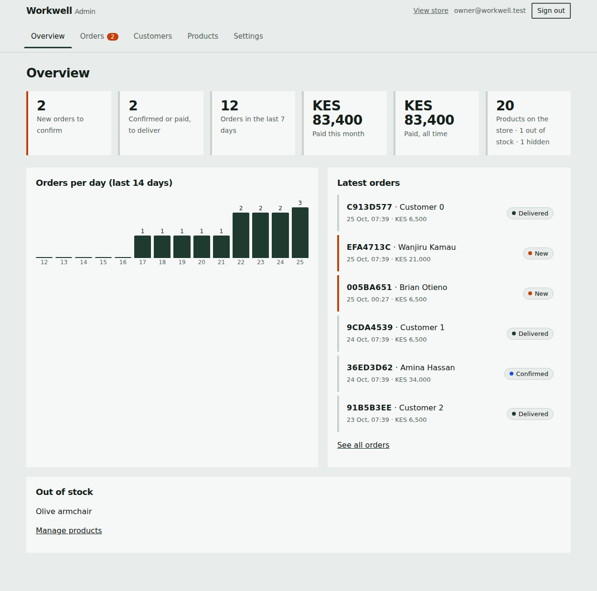

# Workwell Interiors

Online shop and admin dashboard for **Workwell Interiors**, a furniture and home décor shop in Nairobi, Kenya.

- **Store** (`index.html`): browse 21+ products in KES, search, filter and sort, favourites, photo gallery, an order cart that sends the order to WhatsApp, M-Pesa payment instructions, delivery details and an FAQ. Customers can optionally create an account to see their past orders.
- **Admin dashboard** (`admin.html`): orders, customers, products and photos, for the shop owner only.
- **Backend**: [Supabase](https://supabase.com) (Postgres database, Auth, Storage). No server of your own is needed.

Plain HTML, CSS and JavaScript. No build step, no framework, no external scripts. Each page is one self-contained file.



## What is in this repository

```
index.html                           The public store (one self-contained file)
admin.html                           The admin dashboard (one self-contained file)
supabase/01-workwell-supabase-setup.sql   Database: products, orders, client accounts, place_order()
supabase/02-workwell-admin-setup.sql      Admin role, photo storage, tighter permissions
docs/screenshots/                    Screenshots of the dashboard (sample data)
```

## How it works

- Guests can order without an account. The order opens as a WhatsApp message to the shop **and** is saved in the database through a server-side function, `place_order()`, which looks prices up itself so a customer can never change what they pay.
- If Supabase cannot be reached, the store still works as a WhatsApp-only shop using the product list built into `index.html`.
- Prices, stock, photos, visibility and display order come from the `products` table when it is reachable, so changes in the dashboard show on the store on the next page load. The built-in list in `index.html` is only the fallback.
- Permissions are enforced by the database (row-level security), not by the web pages. The pages contain only the **public** anon key, which is safe to expose.

## Set up your own copy

1. **Create a Supabase project** at supabase.com.
2. In **SQL Editor**, run `supabase/01-workwell-supabase-setup.sql`, then `supabase/02-workwell-admin-setup.sql`. Check that the `products` table has 21 rows.
3. **Create your admin login:** Authentication > Users > Add user, enter your email and a strong password, and tick *Auto Confirm User*. Then run this in the SQL Editor, with your email:
   ```sql
   insert into public.admins (user_id)
   select id from auth.users where email = 'YOUR-EMAIL-HERE'
   on conflict do nothing;
   ```
4. **Point the pages at your project.** In Project Settings > API copy the *Project URL* and the *anon / publishable* key. Paste them into:
   - `index.html`: search for `SUPABASE_URL` and `SUPABASE_ANON_KEY`
   - `admin.html`: search for `CFG_URL` and `CFG_KEY`

   Never use the `service_role` or secret key. Both pages refuse to run if they detect one.
5. **Authentication > URL Configuration:** set the Site URL to your domain and add `https://yourdomain/` and `https://yourdomain/admin.html` to the Redirect URLs, so password-reset emails come back to the right page. Add custom SMTP before going live, because the built-in email sender is heavily rate-limited.
6. **Host the two HTML files** on any static host (Hostinger `public_html`, GitHub Pages, Netlify). They need to be served over HTTPS.
7. Open `/admin.html`, sign in, and look after the shop.

## Day to day

- **Change a price, mark something out of stock, hide a product, add a product or photos:** Admin > Products. Nothing needs re-uploading.
- **New orders:** Admin > Orders. Confirm, mark paid or delivered, message the customer on WhatsApp, export to CSV.
- **WhatsApp / M-Pesa number:** search for `0700357702`, `0700 357 702` and `254700357702` in `index.html`, and `0700357702` in `admin.html`.

## Security model

| Who | Can do |
| --- | --- |
| Anyone | Read visible products, place an order through `place_order()` |
| Signed-in client | Also read their own orders and edit their own profile |
| Admin (listed in `public.admins`) | Manage products and photos, read and update all orders |

- The dashboard can change an order's *status* only. It cannot change totals or customer details.
- Nobody can make themselves an admin from the website. Admins are added in the Supabase SQL Editor only.
- Only admins can upload or delete product photos. Anyone can view them.
- Anyone can call `place_order()` (that is how guests order), so fake orders are possible. Delete them in the dashboard. Rate limits can be added later.

## Known limits

- The 21 original product photos are embedded in `index.html`. Upload a replacement in a product's Edit screen to override one. Deleting an original product hides it on the store, but its photo stays in the file.
- Free Supabase projects can pause after about a week without activity. A paused project means ordering falls back to WhatsApp-only and the dashboard cannot sign in until the project is restored.
- Export orders and products to CSV from the dashboard now and then. Check your Supabase plan for backups.
- Tested in Chrome. Test on Safari and Firefox before relying on them.

## Troubleshooting

- **"Not set up yet" on the admin page:** the URL and key were not pasted into `admin.html`.
- **"No admin access":** the account is not in `public.admins`. Run the step 3 query again.
- **Store shows the built-in prices:** Supabase is unreachable or paused, or the URL and key in `index.html` are wrong.
- **Reset email opens the wrong page:** fix the Site URL and Redirect URLs (step 5).
